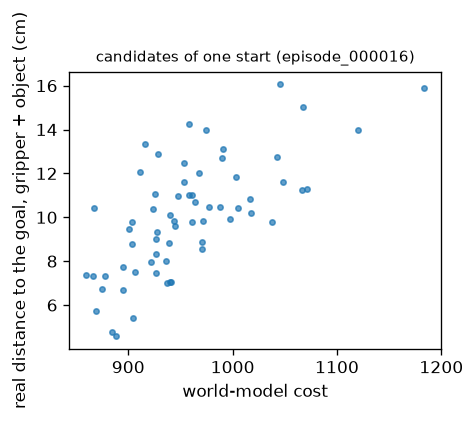

# Human-to-Robot

Does a world model learned from videos of people help a robot act as much as one learned from robot videos? Each world
model learns from video alone: an inverse dynamics model (IDM) infers a latent action between two frames, and a
predictor rolls the scene forward with it. A small controller maps the robot's real actions to these latent actions.
A planner (CEM) then searches for the robot actions whose predicted outcome reaches a goal frame. We compare two world
models with the same code, compute and number of training frames: one learned from phone videos of a person, one
from real robot videos. The task is picking a cube in simulation (robosuite, Panda, Lift).

_To be added: short video, a human manipulation next to the planner's episode in robosuite._

## Results

Run 1: horizon 5 (trained and planned), 12.2 min of phone video from one camera angle, 102 robot videos. Run 2:
horizon 2, 20.5 min of phone video with a second camera angle, 173 robot videos.

### Pick success

30 test episodes, the same initial states and goal frames for every policy. Success: the cube lifted 4 cm while
grasped. Interval: Wilson 95%.

| Policy | Success (95% interval) | Reached | Grasped |
|---|---|---|---|
| random | 0% (0-11) | 13% | 3% |
| replay of the demonstration, 3 runs | 73-87% | 87-93% | 77-90% |
| run 1 planner, phone world model | 0% (0-11) | 0% | 0% |
| run 1 planner, robot world model | 0% (0-11) | 3% | 7% |
| run 2 planner, phone world model | 0% (0-11) | 0% | 0% |
| run 2 planner, robot world model | 0% (0-11) | 3% | 3% |

Reached: the gripper came within 3 cm of the cube. Replay plays the demonstration's measured actions again, open loop:
it checks the action interface and is not a ceiling. Replaying the same actions changes the outcome of 3 or 4 of the
30 episodes from one run to the next (two runs on Colab, one on a Mac). No planner picked a cube in either run.


The same test state in run 2. With the phone world model, the arm barely moves from its start. With the robot world
model, it moves a lot, goes down next to the cube and wanders around it. In run 1 ([phone](docs/figures/pick-phone-failure.png),
[robots](docs/figures/pick-robots-failure.png)) the phone planner raised the arm out of view, and the robot planner
went over the cube and down without grasping it. Through the controller, the run 2 phone model's predicted states
do not follow the commands (counterfactual direction -0.01, below), which fits an arm that barely moves.

### World models

Validation on each model's own videos, at the checkpoint kept (best mean skill). skill(h) = 1 - error / error of
repeating the last frame, h steps ahead: above 0, the model predicts better than no change. Controllability = how much
the prediction depends on the latent action (0: ignored).

| | Run 1 phone | Run 1 robots | Run 2 phone | Run 2 robots |
|---|---|---|---|---|
| Horizon H | 5 | 5 | 2 | 2 |
| Checkpoint kept (step of 1000) | 250 | 450 | 1000 | 650 |
| skill h1 / hH | -0.07 / 0.15 | -0.66 / -0.64 | 0.17 / 0.29 | -0.49 / -0.52 |
| Controllability | 0.26 | 0.06 | 0.40 | 0.09 |
| Active latent dimensions (of 128) | 127 | 74 | 89 | 71 |

Training curves: run 2 [phone](docs/figures/curves-wm-phone-h2.png), [robots](docs/figures/curves-wm-robots-h2.png);
run 1 [phone](docs/figures/curves-wm-phone.png), [robots](docs/figures/curves-wm-robots.png).


- In run 2 the phone model beats repeating the last frame from step 300, when it starts training on its own
  predictions (K = 2). The robot model never does.
- Their one-step errors are close in absolute terms (0.152 and 0.154 at the checkpoints kept). Repeating the last frame
  is a much stronger baseline on the robot videos, where little moves between two frames.
- In both runs the robot model's latent action barely matters (controllability 0.06 and 0.09). In run 2 it collapsed
  early, with no active dimension from step 100 to 300, and only partly recovered.
- The robot model overfits after step 650 in run 2: validation error rises while training error keeps falling. Its
  videos come from 6 datasets with different scenes, and the validation videos come from other scenes.

Run 1, each world model on each validation set (skill at 1 and 5 steps):

| World model | on phone | on robots | on simulation |
|---|---|---|---|
| phone | -0.07 / 0.15 | -2.16 / -2.59 | -3.29 / -2.95 |
| robots | -0.61 / -0.77 | -0.66 / -0.64 | -2.46 / -2.68 |

On the other domains, controllability falls to 0.03-0.08.

Run 2, the same with skill at 1 and 2 steps (controllability in brackets):

| World model | on phone | on robots | on simulation |
|---|---|---|---|
| phone | 0.17 / 0.29 (0.40) | -1.89 / -2.49 (0.08) | -2.14 / -2.45 (0.09) |
| robots | -0.78 / -1.03 (0.02) | -0.49 / -0.52 (0.09) | -2.31 / -2.49 (0.04) |

- No world model predicts the simulated images better than no change.
- One step ahead on the simulation, the phone model goes from -3.29 in run 1 to -2.14. It is now ahead of the robot
  model (-2.31), and its latent action matters more there (controllability 0.09 against 0.04).
- The robot model transfers to the phone videos better than the phone model transfers to the robot videos.

### Controllers

Validation on held-out simulated episodes (8,400 transitions), at the best validation loss. R² of the predicted latent
action against the IDM's:

| | Run 1 phone | Run 1 robots | Run 2 phone | Run 2 robots |
|---|---|---|---|---|
| Validation loss | 1.06 | 0.60 | 1.24 | 1.05 |
| Validation R² | 0.60 | 0.79 | 0.51 | 0.72 |

Each controller targets its own world model's latent actions, so the values compare controllers of the same world
model, not world models with each other. In both runs the robot world model's latent action is easier to predict
from the robot action. Its latent action also matters less to the prediction (controllability 0.06 and 0.09).

Curves: run 1 [phone](docs/figures/curves-ctrl-phone.png), [robots](docs/figures/curves-ctrl-robots.png); run 2
[phone](docs/figures/curves-ctrl-phone-h2.png), [robots](docs/figures/curves-ctrl-robots-h2.png).

### Diagnostics in simulation

10 test episodes, H steps ahead. "IDM" uses the latent actions inferred from the real frames (the world model alone),
"controller" the latent actions the controller gives for the commands played (what the planner scores).

| | Run 1 phone | Run 1 robots | Run 2 phone | Run 2 robots |
|---|---|---|---|---|
| skill h1 / hH, IDM | -5.61 / -4.05 | -4.14 / -4.00 | -3.48 / -3.70 | -3.98 / -3.97 |
| skill h1 / hH, controller in the loop | -5.75 / -3.99 | -4.16 / -3.92 | -3.51 / -3.79 | -4.06 / -4.16 |
| Counterfactual identification, IDM / controller (chance 0.12) | 0.39 / 0.21 | 0.21 / 0.16 | 0.15 / 0.12 | 0.20 / 0.21 |
| Counterfactual direction, IDM / controller | 0.27 / 0.15 | 0.22 / 0.20 | 0.22 / -0.01 | 0.22 / 0.15 |
| Counterfactual spread, IDM / controller | 0.68 / 0.36 | 0.46 / 0.33 | 0.63 / 0.26 | 0.36 / 0.32 |
| Ranking: Spearman cost vs real outcome | 0.66 | 0.75 | 0.79 | 0.74 |
| Ranking: regret | 8.7 cm | 3.3 cm | 2.1 cm | 2.6 cm |

- Prediction: on simulated images every world model predicts worse than no change, even with the IDM's latent
  actions. The controller in the loop adds almost no error (ratio 0.98-1.04).
- Counterfactual: from one state, several command sequences are played and predicted. Identification: share of
  predictions closest to their own real outcome. Direction: cosine between predicted and real differences of outcomes.
  Spread: predicted over real distance between outcomes. In run 1, predictions follow the commands a little, and they
  are about 3 times closer to each other than the real outcomes.
- In run 2, the phone model's predictions no longer follow the commands through the controller: identification at
  chance, direction -0.01. With the IDM's latent actions they still do (direction 0.22). The effect of the command is
  lost between the robot action and the latent action. The robot model's controller keeps most of it (direction 0.15
  against 0.22 with the IDM).
- Ranking: the planner's cost orders candidate sequences roughly like their real distance to the first goal (Spearman
  0.66 to 0.79). In run 1 the sequence it prefers is 8.7 cm and 3.3 cm worse than the best one, in run 2 2.1 cm and
  2.6 cm. The ranking only uses the predicted distance to the goal, so it can hold while the predicted states
  themselves do not follow the commands.

For one test start: the real next frames (top) and, for each predicted state, the nearest real frame of the other
test episodes (bottom). The real gripper already holds the cube. In run 2 the phone model's predictions match frames
where the cube is still on the table, away from the gripper; the robot model's match frames with the cube in the
gripper. In run 1 the phone model's do so at steps 2 and 3 of 5. One start per model, so this illustrates the
numbers above and does not measure anything.


Run 1: [phone](docs/figures/imagined-phone.png), [robots](docs/figures/imagined-robots.png).



Ranking plots: run 1 [phone](docs/figures/ranking-phone.png), [robots](docs/figures/ranking-robots.png); run 2
[phone](docs/figures/ranking-phone-h2.png), [robots](docs/figures/ranking-robots-h2.png).

## Method

```
frames -> Encoder -> states -> IDM -> latent actions -> Predictor -> next state       (video only)
robot action + state -> Controller -> latent action                                   (robot episodes)
current frames, goal frame -> CEM over robot actions, through Controller and Predictor -> next robot action
```

- **Encoder**: frozen DINOv2-small, then a trained projector to a 4 x 4 x 128 state per frame.
- **IDM and Predictor (world model)**: the IDM infers a latent action from two consecutive states; the predictor
  takes 3 past states and their latent actions and predicts the next state. Trained together on video only:
  prediction error, SIGReg against collapse of the states, KL on the latent action. It also learns to continue from
  its own predictions (K steps).
- **Controller**: maps a real robot action and the current state to the latent action the IDM would infer. Trained
  on simulated episodes, the world model frozen.
- **Planner**: CEM over the gripper's displacement and opening, 300 samples, 10 elites, 10 iterations, horizon 2 (5 in run 1).
  The cost is the distance between the predicted state and the goal state. It executes the first action and plans
  again after every observation.

## Data

| | Videos (train / val / test) | Content |
|---|---|---|
| Human ([h2r-phone](https://huggingface.co/datasets/batgre/h2r-phone)) | 124 / 14 / 20, 20.5 min | a person handling objects, filmed with a phone |
| Robots ([h2r-robots-1h30](https://huggingface.co/datasets/batgre/h2r-robots-1h30)) | 173 of 712 used for training | real robot videos from 6 Open-X datasets (LeRobot): DROID, Berkeley UR5, Jaco Play, TACO Play, Stanford Kuka, RoboTurk |
| Simulation ([h2r-sim-v3](https://huggingface.co/datasets/batgre/h2r-sim-v3)) | 1,100 scripted + 1,100 random episodes, split 70 / 10 / 20 (61,680 / 8,400 transitions for the controllers) | robosuite Panda, Lift, `agentview` camera, 40 actions per episode, with the actions |

The world models only see the human or the robot videos. The simulation is only used for the controllers and the
evaluation. All videos are sampled at 4 fps and 224 px and split by video.

Phone videos: _to be added: how they were filmed (scene, objects, camera position)_. Two camera angles: the first 81
videos (65 / 6 / 10) from one angle, the next 77 (59 / 8 / 10) from another. Location metadata and audio are removed
before upload.

Trained model: the world model learned from human videos (run 2) and its controller, in
[batgre/h2r-lift](https://huggingface.co/batgre/h2r-lift) ([world model](https://huggingface.co/batgre/h2r-lift/tree/main/wm-phone-h2),
[controller](https://huggingface.co/batgre/h2r-lift/tree/main/ctrl-phone-h2)).

## Reproduce

`lift.ipynb` runs every step below on Colab, in order.

```bash
uv sync
uv run hf auth login && uv run wandb login     # ffmpeg is also needed (brew install ffmpeg on macOS)
```

**Run the trained planner** on 5 test states:

```bash
uv run hf download batgre/h2r-lift --local-dir outputs --include "wm-phone-h2/*" --include "ctrl-phone-h2/*"
uv run hf download batgre/h2r-sim-v3 --repo-type dataset --local-dir data/h2r-sim --include "raw/Panda/Lift/scripted/*"
uv run h2r eval pick --set name=try controller=outputs/ctrl-phone-h2 "policies=[planner]" episodes=5 planner.horizon=2
```

Results in `outputs/try/results.json`, frames of a success and of a failure in `episode_success.png` and
`episode_failure.png`.

**Train again** (data, world models, controllers, pick):

```bash
uv run hf download batgre/h2r-phone --repo-type dataset --revision 815bfb769aa6fc2059fe746381473915a2fb665d --local-dir data/h2r-phone --exclude "raw/*"
uv run hf download batgre/h2r-robots-1h30 --repo-type dataset --local-dir data/h2r-robots-1h30
uv run hf download batgre/h2r-sim-v3 --repo-type dataset --local-dir data/h2r-sim

H="rollout_steps.end=2 val_horizon=2 iterations=1000 eval_every=50"
uv run h2r train --set name=wm-phone-h2 data.root=data/h2r-phone/ data.hf_repo=batgre/h2r-phone $H
uv run h2r train --set name=wm-robots-h2 data.root=data/h2r-robots-1h30/ data.hf_repo=batgre/h2r-robots-1h30 data.max_videos=173 $H
uv run h2r controller train --set name=ctrl-phone-h2 world_model=outputs/wm-phone-h2 iterations=4000 eval_every=100
uv run h2r controller train --set name=ctrl-robots-h2 world_model=outputs/wm-robots-h2 iterations=4000 eval_every=100

uv run h2r eval pick --set name=pick-baselines-v3 "policies=[random, replay]" episodes=30
uv run h2r eval pick --set name=pick-phone-h2 "policies=[planner]" controller=outputs/ctrl-phone-h2 episodes=30 planner.horizon=2
uv run h2r eval prediction --set controller=outputs/ctrl-phone-h2 horizon=2        # also counterfactual, ranking, planning, interface
```

Every command takes `--config` and `--set key=value ...` (nested keys with dots). A run goes to `outputs/<name>`;
running a training again continues it from `last.pt`, and an evaluation that already wrote `results.json` is skipped.
`h2r data extract`, `h2r data collect` and `h2r data push` rebuild the datasets (`configs/data/`). Tests:
`uv run pytest`.

## Experimental setup and limitations

**Fair comparison.** Both world models have the same code, settings, 1,000 steps and number of training frames
(4,181 phone, 4,183 robot). The robot videos are the first 173 of a seeded shuffle, the number that matches the
phone's frames. Robot videos are shorter, so they give 3,491 training clips against 3,685. Both controllers are
trained on the same simulated episodes. Every policy starts from the same test states.

**Goal frames come from demonstrations.** For each test episode, the planner gets the pre-grasp, grasp and lift
frames of the scripted episode that started from the same state. The lift is about 30 steps away, beyond the
planner's horizon.

| Training | World models | Controllers |
|---|---|---|
| Steps, batch | 1,000 steps (about 36 passes), 128 clips of 5 frames | 4,000 steps (about 17 passes), 256 transitions |
| Optimizer | Muon 0.02 and AdamW 2.2e-4, warmup 10%, cosine | AdamW 1e-3, warmup 300, cosine |
| Losses | prediction MSE + SIGReg 0.09 + KL 1e-3; K from 1 to 2 over the first half | L2 to the IDM's latent action |
| Kept | best validation skill, every 50 steps | best validation loss, every 100 steps |

**Limitations.**
- 20 minutes of human video, one person, one task, in simulation only.
- One seed per world model, 30 test episodes.
- skill compares each model to repeating the last frame on its own videos, so its value depends on how much those
  videos move. The comparison that matters is the pick.
- Run 1 and run 2 change several things at once (horizon, amount of video, camera angle), so the gain between them is
  not attributed to one of them.

## References and acknowledgments

`src/h2r/models/jepa.py` and `src/h2r/models/module.py` are adapted from
[LeWorldModel](https://github.com/lucas-maes/le-wm) (Copyright (c) 2026 Lucas Maes), released under the MIT
license, in [`LICENSES/LeWM-MIT.txt`](LICENSES/LeWM-MIT.txt). The IDM, the controller and the training values follow
Garrido et al. 2026.

- Lucas Maes, Quentin Le Lidec, Damien Scieur, Yann LeCun, Randall Balestriero. _LeWorldModel: Stable End-to-End
  Joint-Embedding Predictive Architecture from Pixels._ arXiv:2603.19312, 2026.
- Quentin Garrido, Tushar Nagarajan, Basile Terver, Nicolas Ballas, Yann LeCun, Michael Rabbat. _Learning Latent
  Action World Models In The Wild._ arXiv:2601.05230, 2026.
- Basile Terver et al. _What Drives Success in Physical Planning with Joint-Embedding Predictive World Models?_
  TMLR, 2026.
- Maxime Oquab et al. _DINOv2: Learning Robust Visual Features without Supervision._ TMLR, 2024.
- Open X-Embodiment Collaboration. _Open X-Embodiment: Robotic Learning Datasets and RT-X Models._ 2023.
- Yuke Zhu et al. _robosuite: A Modular Simulation Framework and Benchmark for Robot Learning._ 2020.
