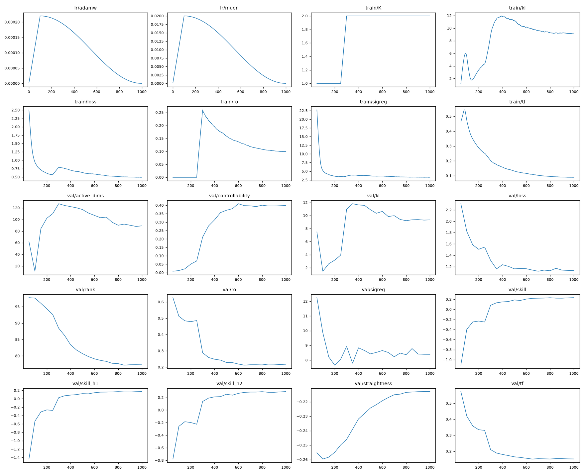
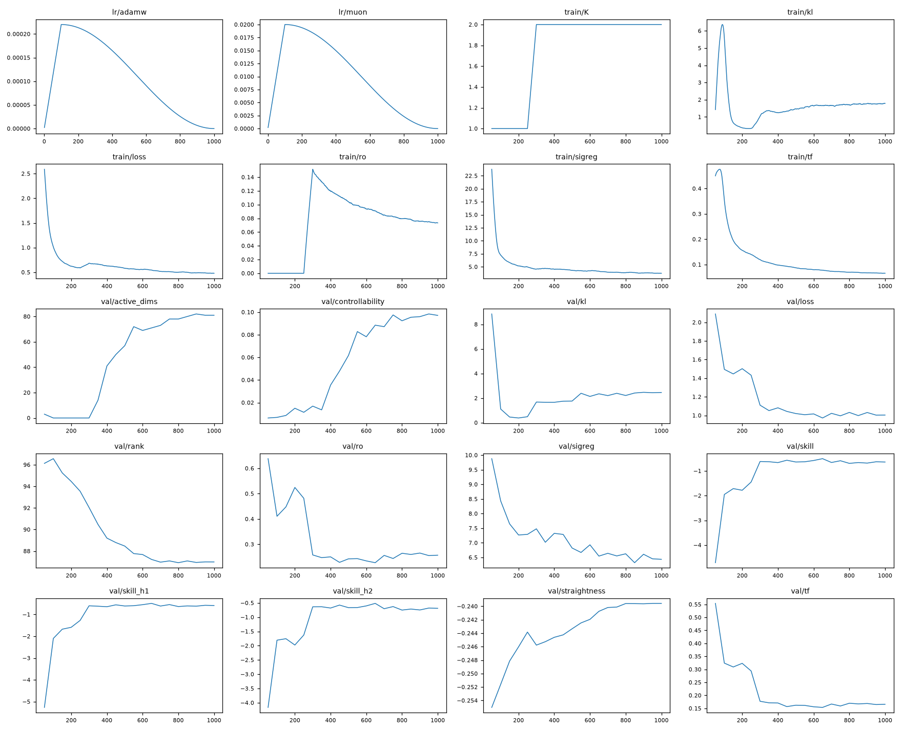
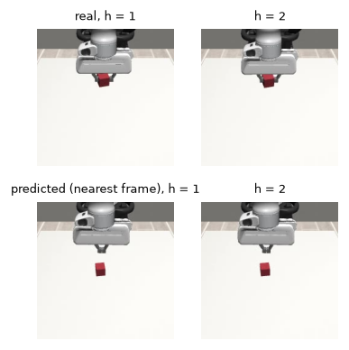
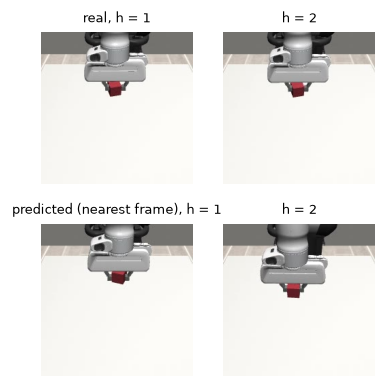
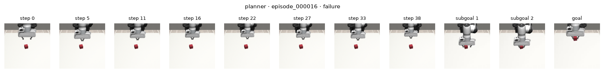
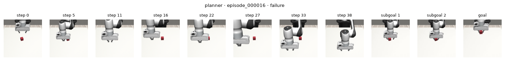

# Human-to-Robot

**Learning action-conditioned world models from unlabeled manipulation videos**

This project investigates whether a world model can learn useful action representations and visual dynamics directly from manipulation videos, without ground-truth action labels.

We jointly train an inverse dynamics model (IDM) and a JEPA-style world model. The IDM infers latent actions from consecutive visual observations; the world model predicts future representations conditioned on these actions. Multi-step autoregressive training makes the predictor learn from its own predicted states.

We compare models trained on personally recorded human videos and videos of real robots, focusing on prediction quality, action conditioning, representation collapse, and generalization across domains. Goal-conditioned planning in Robosuite is a downstream experiment, not part of world-model pretraining.

**Artifacts:** [iPhone manipulation videos](https://huggingface.co/datasets/batgre/h2r-phone) · [Real-robot videos](https://huggingface.co/datasets/batgre/h2r-robots-1h30) · [Robosuite episodes](https://huggingface.co/datasets/batgre/h2r-sim-v3) · [Model checkpoints](https://huggingface.co/batgre/h2r-lift)

## Run the simulation

Run the **pretrained** human-video world model and controller in Robosuite Panda Lift. No training is required. From the repository root:

```bash
uv sync

uv run hf download batgre/h2r-lift \
  --local-dir outputs \
  --include "wm-phone-h2/*" \
  --include "ctrl-phone-h2/*"

uv run hf download batgre/h2r-sim-v3 \
  --repo-type dataset \
  --local-dir data/h2r-sim \
  --include "raw/Panda/Lift/scripted/*"

uv run h2r eval pick --set \
  name=demo-phone-h2 \
  controller=outputs/ctrl-phone-h2 \
  "policies=[planner]" \
  episodes=5 \
  planner.horizon=2
```

The simulator restores five held-out initial states and runs the CEM planner in closed loop: execute one robot action, observe the result, and replan. Results are written to `outputs/demo-phone-h2/results.json`; a filmstrip of an unsuccessful episode is saved as `outputs/demo-phone-h2/episode_failure.png`. A success filmstrip is only saved if an episode succeeds.

This is a **headless evaluation** that saves images and metrics, not a live GUI or MP4 video. In the reported runs, the planner did not successfully lift the cube.


## Architecture

The IDM and predictor are trained jointly on unlabeled video. The visual encoder is frozen.

```text
video frames ──> frozen DINOv2-small ──> learned projector ──> visual states sₜ
                                                           │
                                    (sₜ, sₜ₊₁) ──> IDM ──> latent action zₜ
                                                           │
                        (past visual states, latent actions) ──> predictor ──> ŝₜ₊₁
```

| Component | Implementation | Output |
|---|---|---|
| **Visual encoder** | Frozen DINOv2-small; 224 × 224 inputs | Patch features per frame |
| **Projector** | Two stride-2 convolutions | 4 × 4 tokens, dimension 128 |
| **IDM** | Two-layer Transformer attending jointly to consecutive frames, learned query, Gaussian readout | One 128-dimensional latent action per transition |
| **Predictor** | Six-layer causal Transformer conditioned by latent actions through AdaLN | Next-state patch tokens |
| **Prediction projection** | Learned MLP | Predicted state in the visual latent space |

The IDM parameterizes a Gaussian latent action distribution. It samples using reparameterization during training and uses the posterior mean at evaluation. The model has approximately **2.94 million trainable parameters**, excluding the frozen visual encoder.

The predictor accepts a history of three observed or predicted visual states and the latent actions connecting them. During autoregressive rollout, each predicted state can become an input to the next step.

Implementation: [`idm.py`](src/h2r/models/idm.py), [`jepa.py`](src/h2r/models/jepa.py), [`module.py`](src/h2r/models/module.py).

## Training

Both models learn from **video only**. No joint states, object poses, robot commands, or action labels are used to train the IDM and world model.

The joint objective is:

```text
L = L_teacher_forcing + L_rollout + 0.09 L_SIGReg + 0.001 L_KL
```

| Term | Role |
|---|---|
| Teacher-forced MSE | Predict the next encoded state from observed context and IDM actions |
| Rollout MSE | Predict multiple future states using the model's own previous predictions |
| SIGReg | Discourage collapse of learned visual representations |
| KL divergence | Regularize the IDM's Gaussian action distribution |

Training starts with one-step prediction and increases the autoregressive rollout length over the first half of training. Predicted-state inputs are detached between rollout steps (truncated backpropagation through time); the inferred actions still receive gradients.

**Experimental settings:** three-frame context, 128 clips per batch, 1,000 optimizer steps, Muon for Transformer matrices and AdamW for the remaining trainable parameters, cosine learning-rate scheduling and a 10% warmup. The checkpoint with the highest mean validation prediction skill is retained.

Two experiments were run:

| | Run 1 | Run 2 |
|---|---|---|
| Rollout horizon | 5 steps | 2 steps |
| Human video | 12.2 min, one camera angle | 20.5 min, two camera angles |
| Robot video | 102 videos | 173 videos |
| Training | 1,000 steps | 1,000 steps |

Run 2 uses nearly the same number of sampled training frames for both world models (4,181 human and 4,183 robot), but their scene diversity, motion statistics, and number of usable clips differ. Run 1 and Run 2 also change several factors at once and should not be treated as a controlled ablation.

Implementation: [`world_model.py`](src/h2r/training/world_model.py), [model configuration](configs/models/world_model.yaml).

## Experiments & Results

We examine prediction quality, whether the predictor uses latent actions, and how the learned dynamics generalize across human, robot, and simulated-robot observations.

### Prediction on held-out videos

Prediction skill compares the multi-step MSE against a persistence baseline that repeats the last observed state:

```text
skill(h) = 1 - MSE(predicted state at t+h, true state at t+h)
               / MSE(last context state, true state at t+h)
```

**Positive skill** means better prediction than persistence. This evaluation uses latent actions inferred by the IDM from real future frame pairs (oracle actions). It measures the predictor and inferred-action representation, **not** the ability to choose future actions independently.

Results below are computed on each model's own held-out video split, at its selected checkpoint:

| Model | Horizon | Skill (step 1 / final step) | Controllability | Active IDM dimensions / 128 |
|---|---:|---:|---:|---:|
| Run 1, human | 5 | -0.07 / 0.15 | 0.26 | 127 |
| Run 1, robot | 5 | -0.66 / -0.64 | 0.06 | 74 |
| Run 2, human | 2 | **0.17 / 0.29** | **0.40** | 89 |
| Run 2, robot | 2 | -0.49 / -0.52 | 0.09 | 71 |

In Run 2, the human-video model outperforms persistence on its held-out videos, while the robot-video model does not. Their absolute one-step validation MSE values are similar (0.152 and 0.154), but these losses are measured on different datasets and model-specific representation spaces. Persistence is harder to beat on robot videos with little frame-to-frame motion. Skill values across these datasets therefore do not provide a direct model-quality ranking.

**Run 2 training curves.** The human-video model improves its validation prediction skill as the rollout horizon increases from one to two steps.



### Does the predictor use the latent action?

A predictor may reduce its loss while ignoring the action input. We measure **controllability** by comparing teacher-forced prediction error with the correct IDM actions against error after shuffling actions across clips. A value near zero indicates little sensitivity to this intervention.

At the selected Run 2 checkpoints, controllability is **0.40** on human videos and **0.09** on robot videos. The robot-video IDM also shows partial action collapse during training: its active action dimensions drop to zero early in Run 2 and recover only partially.

Action sensitivity is necessary but insufficient evidence of useful control. It does not establish that individual latent dimensions have stable physical meanings.

**Robot-video model training curves.** Compare the validation skill, controllability, and active IDM dimensions with the human-video run above.



### Cross-domain generalization

Each Run 2 model is evaluated without fine-tuning on held-out human videos, real-robot videos, and Robosuite observations.

| World model trained on | Human test videos | Real-robot test videos | Robosuite |
|---|---|---|---|
| Human | 0.17 / 0.29 | -1.89 / -2.49 | -2.14 / -2.45 |
| Robot | -0.78 / -1.03 | -0.49 / -0.52 | -2.31 / -2.49 |

*Entries are prediction skill at steps 1 / 2, using IDM-inferred actions.*

Neither model outperforms persistence on simulated robot observations. Controllability also drops substantially when the video domain changes. The gap between in-domain prediction and cross-domain transfer remains the main limitation.

**Qualitative predictions in Robosuite.** The top row shows real future frames; the bottom row shows the real frames nearest to the model's *predicted latent states*. These are nearest-neighbor visualizations, **not images decoded by the world model**, and they illustrate individual examples rather than aggregate performance.

| Human-video world model | Robot-video world model |
|:---:|:---:|
|  |  |

## Data and checkpoints

### Video datasets

| | Videos (train / val / test) | Content |
|---|---|---|
| **iPhone recordings** ([browse videos on Hugging Face](https://huggingface.co/datasets/batgre/h2r-phone)) | 124 / 14 / 20, 20.5 min | Unlabeled, real human object manipulation, personally recorded on an iPhone |
| **Real-robot videos** ([browse on Hugging Face](https://huggingface.co/datasets/batgre/h2r-robots-1h30)) | 173 of 712 used for training | Real robot demonstrations from six Open-X datasets (LeRobot): DROID, Berkeley UR5, Jaco Play, TACO Play, Stanford Kuka, RoboTurk |
| **Simulated robot episodes** ([browse on Hugging Face](https://huggingface.co/datasets/batgre/h2r-sim-v3)) | 1,100 scripted + 1,100 random episodes, split 70 / 10 / 20 (61,680 / 8,400 transitions for the controllers) | Robosuite Panda Lift, `agentview`, 40 actions per episode, with actions |

The world models only see the human or the robot videos. The simulation is only used for the controllers and the
evaluation. All videos are sampled at 4 fps and 224 px and split by video.

Phone videos were recorded from two camera angles: the first 81
videos (65 / 6 / 10) from one angle, the next 77 (59 / 8 / 10) from another. Location metadata and audio are removed before upload.

### Trained models

All released checkpoints and their configs are hosted at **[batgre/h2r-lift](https://huggingface.co/batgre/h2r-lift)** on Hugging Face.

| Training videos | World model + IDM | Downstream controller |
|---|---|---|
| Human / iPhone — Run 1 (H=5) | [wm-phone](https://huggingface.co/batgre/h2r-lift/tree/main/wm-phone) | [ctrl-phone](https://huggingface.co/batgre/h2r-lift/tree/main/ctrl-phone) |
| Real robot — Run 1 (H=5) | [wm-robots](https://huggingface.co/batgre/h2r-lift/tree/main/wm-robots) | [ctrl-robots](https://huggingface.co/batgre/h2r-lift/tree/main/ctrl-robots) |
| Human / iPhone — Run 2 (H=2) | [wm-phone-h2](https://huggingface.co/batgre/h2r-lift/tree/main/wm-phone-h2) | [ctrl-phone-h2](https://huggingface.co/batgre/h2r-lift/tree/main/ctrl-phone-h2) |
| Real robot — Run 2 (H=2) | [wm-robots-h2](https://huggingface.co/batgre/h2r-lift/tree/main/wm-robots-h2) | [ctrl-robots-h2](https://huggingface.co/batgre/h2r-lift/tree/main/ctrl-robots-h2) |

## Downstream control

We freeze each world model and train a small controller on Robosuite transitions to predict the IDM latent action from the robot's measured end-effector action and current visual state. CEM then searches over candidate robot actions, rolls them out through the controller and world model, executes the first action, and replans after observing the result.

This is an experimental test of whether learned visual dynamics are usable for action selection. In both runs, **neither planner lifted the cube successfully in 30 held-out Robosuite Lift episodes**. The demonstration-replay baseline succeeds in 73–87% of trials across three repeated evaluations, while random control succeeds in none. The planner receives pre-grasp, grasp, and lift goal frames extracted from the test demonstration; these subgoals are supplied, not discovered.

Thus the current results support limited in-domain learning of action-conditioned visual dynamics, **not successful human-to-robot transfer**.

**Example failures (Run 2).** Each filmstrip shows the executed episode followed by the provided visual subgoals and final goal.





### Why the planner fails

Diagnostics on 10 held-out Robosuite episodes ([`src/h2r/eval/`](src/h2r/eval)) locate four problems, from the world model to the task. "IDM" uses latent actions inferred from the real frames; "controller" uses the latent actions the controller gives for the commands played, which is what the planner scores.

| Run 2 | Human-video model | Robot-video model |
|---|---:|---:|
| Skill at step 1, IDM / controller | -3.48 / -3.51 | -3.98 / -4.06 |
| Counterfactual direction, IDM / controller | 0.22 / -0.01 | 0.22 / 0.15 |
| Ranking: Spearman cost vs real outcome / regret | 0.79 / 2.1 cm | 0.74 / 2.6 cm |
| Offline planning Δxyz, planner / no motion | 10.9 / 2.8 cm | 33.3 / 2.8 cm |
| Same, each step capped at 2 cm | 4.6 / 2.8 cm | 5.3 / 2.8 cm |

*Counterfactual direction: cosine between predicted and real differences of outcomes when several command sequences are played from one state. Offline planning follows Garrido et al.: 64 random clips, the real frame H steps ahead as goal, no simulator; Δxyz is the L1 distance between the summed planned and recorded displacements.*

1. **The world models do not predict the simulation.** Every model predicts Robosuite frames worse than persistence, with the IDM's own latent actions too. None saw a simulated frame in training.
2. **The command is lost before the prediction.** With the IDM's latent actions, predicted outcomes follow the commands a little (direction 0.22 for both). Through the controller, the human-video model's no longer do (-0.01); the robot-video model's keep most of it (0.15). The run 2 human-video controller is also the weakest (validation R² 0.51, against 0.72 for the robot-video one).
3. **The planner asks for displacements far larger than the demonstrations.** The controller's action space is standardized (about 2 cm per axis and step), and CEM picks sequences far outside it: every planner is worse than not moving, by 8 to 31 cm in run 2 and by about 33 to 35 cm in run 1 (H = 5). Capping each step at 2 cm divides the error by 2 to 6, but the planned displacement is closer to the recorded one than no motion on only 19% (human) and 12% (robot) of the clips.
4. **The task is longer than the planner's horizon.** The lift is about 30 steps from the start and the planner looks 2 steps ahead, through the given subgoals. A good ranking over 2 steps does not add up to a pick over 38.

The interface is not the cause: replaying the demonstration's measured actions through the same command map succeeds in 73–87% of episodes. The papers this work follows do not test a closed-loop pick from latent actions either: Garrido et al. evaluate planning offline with a goal 3 steps away, and Terver et al. report low success on picking even with world models trained on real actions.

### What did not work

- **Horizon 5 (Run 1).** Both planners picked 0 of 30 cubes; the human-video planner never came within 3 cm of the cube. Horizon 2 improved prediction and offline planning, and still picked none.
- **Robot videos as a source.** 173 videos from 6 datasets with different robots, cameras and scenes: the model never beats persistence on its own held-out videos, overfits after step 650 of 1,000 (validation error rises while training error falls), and its latent action collapsed early in Run 2. Little moves between two frames of these videos; whether this lets the KL term switch the latent action off was not tested.
- **An unconstrained planner** (point 3 above).
- **Diagnostics that do not predict the pick.** In Run 1 the robot-video model had the best controller (R² 0.79) and the best ranking (Spearman 0.75), and picked no cube. A positive skill on the human videos (Run 2) did not transfer to Robosuite.
- **Run 1 to Run 2 on the human side.** More and more varied video (12.2 to 20.5 min, a second camera angle) together with the shorter horizon improved the world model: in-domain skill -0.07 to 0.17 at step 1, Robosuite skill -3.29 to -2.14, controllability 0.26 to 0.40, offline Δxyz 38.2 to 10.9 cm. Its controller got worse (R² 0.60 to 0.51, counterfactual direction 0.15 to -0.01). The changes were made together, so no gain is attributed to one of them.

## Reproduce

`lift.ipynb` runs every step below on Colab, in order.

```bash
uv sync
uv run hf auth login && uv run wandb login     # ffmpeg is also needed (brew install ffmpeg on macOS)
```

The pretrained simulation example is provided in [Run the simulation](#run-the-simulation) above.

**Train again** (data, world models, controllers, pick):

```bash
uv run hf download batgre/h2r-phone --repo-type dataset --revision 815bfb769aa6fc2059fe746381473915a2fb665d --local-dir data/h2r-phone --exclude "raw/*"
uv run hf download batgre/h2r-robots-1h30 --repo-type dataset --local-dir data/h2r-robots-1h30
uv run hf download batgre/h2r-sim-v3 --repo-type dataset --local-dir data/h2r-sim

H="rollout_steps.end=2 val_horizon=2 iterations=1000 eval_every=50"
uv run h2r train --set name=wm-phone-h2 data.root=data/h2r-phone/ data.hf_repo=batgre/h2r-phone $H
uv run h2r train --set name=wm-robots-h2 data.root=data/h2r-robots-1h30/ data.hf_repo=batgre/h2r-robots-1h30 data.max_videos=173 $H
uv run h2r controller train --set name=ctrl-phone-h2 world_model=outputs/wm-phone-h2 iterations=4000 eval_every=100
uv run h2r controller train --set name=ctrl-robots-h2 world_model=outputs/wm-robots-h2 iterations=4000 eval_every=100

uv run h2r eval pick --set name=pick-baselines-v3 "policies=[random, replay]" episodes=30
uv run h2r eval pick --set name=pick-phone-h2 "policies=[planner]" controller=outputs/ctrl-phone-h2 episodes=30 planner.horizon=2
uv run h2r eval prediction --set controller=outputs/ctrl-phone-h2 horizon=2        # also counterfactual, ranking, planning, interface
```

Every command takes `--config` and `--set key=value ...` (nested keys with dots). A run goes to `outputs/<name>`;
running a training again continues it from `last.pt`, and an evaluation that already wrote `results.json` is skipped.
`h2r data extract`, `h2r data collect` and `h2r data push` rebuild the datasets (`configs/data/`). Tests:
`uv run pytest`.

## Experimental setup and limitations

- **Matched world-model budget.** Run 2 uses the same architecture, training steps and approximately the same number of sampled frames for human and robot videos, but not identical motion statistics, video lengths or numbers of clips.
- **Separate training stages.** The simulation is used to fit the downstream action controller and to evaluate control, not to train either video-only world model.
- **Oracle-action prediction metrics.** Validation rollouts use IDM actions inferred from observed future pairs. A high score does not imply that the system can select correct future actions.
- **Data scale.** 20.5 min of human video (4,181 training frames); the world model sees 128,000 clips of 5 frames (1,000 steps of 128). Garrido et al., whose latent action model this follows, train on YouTube-Temporal-1B for 30,000 steps of 1,024 clips of 16 frames (about 240 times more clips) with a ViT-L predictor; ours has 2.9 M trainable parameters. At the selected checkpoints the one-step validation error is 1.7 times the training error for the human-video model and 2.0 times for the robot-video model: both fit their few videos more than they generalize from them.
- **Viewpoints.** The human videos come from two camera angles of one person in one room; Robosuite is seen from a third, and the robot videos from many others.
- **Limited statistical evidence.** One training seed per world model, 30 held-out simulation episodes (0% success has a Wilson 95% interval of 0–11%), 10 episodes for the diagnostics. Replaying the same actions changes the outcome of 3 or 4 of the 30 episodes from one run to the next.
- **Not an ablation.** Run 1 and Run 2 vary the data amount, viewpoints and prediction horizon together.
- **Domain shift.** Neither world model predicts Robosuite dynamics better than persistence; the downstream pick policies fail.

## Next steps

Suggested by the results, not tested:

- **Some in-domain video.** No world model saw a simulated frame and none beats persistence on Robosuite. Garrido et al. (Table S3) find that mixing 10% of in-domain robot video into in-the-wild pretraining lowers their planning error (Δxyz) from 0.14 to 0.09 with noisy latent actions, and to 0.06 with more of it, against 0.05 for a model trained with real actions. The 2,200 simulated episodes already have videos.
- **More and more varied human video.** The only data change between runs (more minutes, a second angle) came with better prediction on every split, and the train–validation gap is large. A camera closer to Robosuite's view is worth testing: Terver et al. had to match the simulator's camera to DROID's for their models to unroll.
- **The KL weight per dataset.** One value (1e-3) was used for both video sources and the robot-video latent action collapsed. Garrido et al. find that neither the most nor the least constrained latent action works best.
- **Fix the controller of the human-video model.** Its latent actions carry the command's direction with the IDM (0.22) but not through the controller (-0.01).
- **A bounded planner in closed loop.** The 2 cm cap helps offline; Garrido et al. also use 15 CEM iterations against our 10.
- **Shorter tasks first.** Reaching the cube, then grasping, before the full pick.
- **An action-conditioned baseline.** A world model trained on the simulated episodes with their actions would tell whether the gap comes from the videos or from learning actions from video.

## References and acknowledgments

`src/h2r/models/jepa.py` and `src/h2r/models/module.py` are adapted from
[LeWorldModel](https://github.com/lucas-maes/le-wm) (Copyright (c) 2026 Lucas Maes), released under the MIT
license, in [`LICENSES/LeWM-MIT.txt`](LICENSES/LeWM-MIT.txt). The IDM, the controller and the training values follow
Garrido et al. 2026.

- Lucas Maes, Quentin Le Lidec, Damien Scieur, Yann LeCun, Randall Balestriero. _LeWorldModel: Stable End-to-End
  Joint-Embedding Predictive Architecture from Pixels._ arXiv:2603.19312, 2026.
- Quentin Garrido, Tushar Nagarajan, Basile Terver, Nicolas Ballas, Yann LeCun, Michael Rabbat. _Learning Latent
  Action World Models In The Wild._ arXiv:2601.05230, 2026.
- Basile Terver et al. _What Drives Success in Physical Planning with Joint-Embedding Predictive World Models?_
  TMLR, 2026.
- Maxime Oquab et al. _DINOv2: Learning Robust Visual Features without Supervision._ TMLR, 2024.
- Open X-Embodiment Collaboration. _Open X-Embodiment: Robotic Learning Datasets and RT-X Models._ 2023.
- Yuke Zhu et al. _robosuite: A Modular Simulation Framework and Benchmark for Robot Learning._ 2020.
