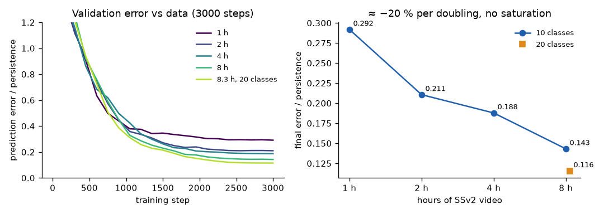
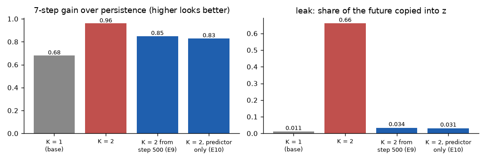
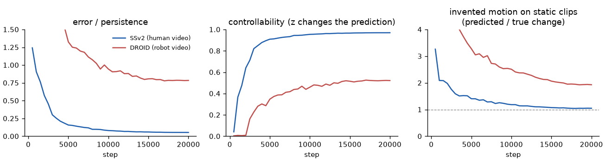
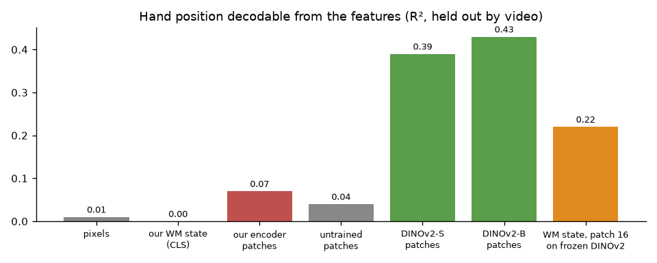
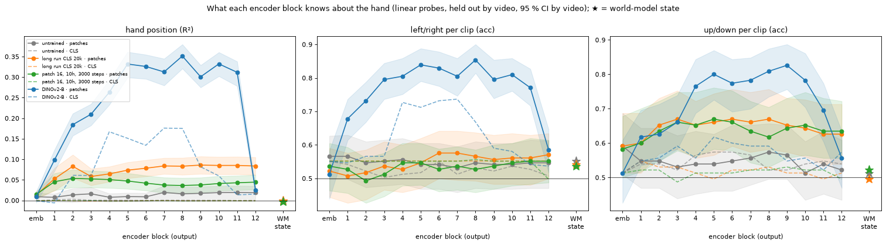
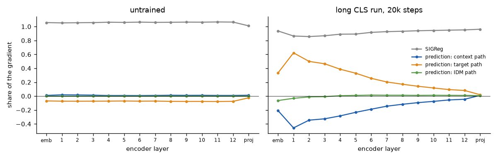
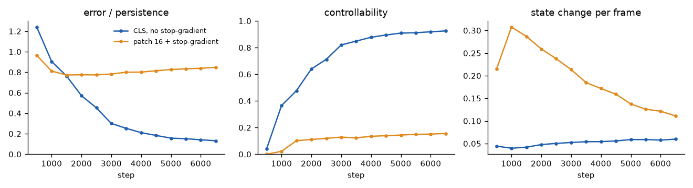
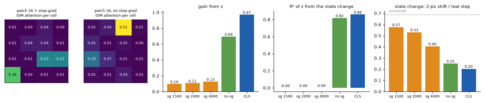

# Human-to-Robot

```bash
uv sync

# raw videos -> frame shards (configs/data/config.yaml)
uv run h2r data extract --set raw_dir=data/raw/ processed_dir=data/processed/

# frame shards -> Hugging Face Hub
uv run h2r data push --set processed_dir=data/processed/ hf_repo=<user>/<dataset>

# DROID episodes for the controller (configs/data/droid.yaml), then extract / push with the same config
uv run h2r data droid
uv run h2r data extract --config configs/data/droid.yaml
uv run h2r data push --config configs/data/droid.yaml

# controller for a trained world model; ablations: --set 'model.inputs=[state]' or 'model.inputs=[action]'
uv run h2r train controller --set world_model=outputs/<wm-run>

# robosuite viewer (configs/env/config.yaml)
uv run python src/h2r/envs/robosuite_env.py

# tests
uv run pytest
```

## Experiments

The model is a JEPA world model (LeWM recipe): a ViT-tiny encoder trained from scratch, an IDM that infers a latent action z from two consecutive states, and a predictor conditioned on z. It is trained on Something-Something v2 (SSv2) video at 4 fps, with no action labels. Each experiment below answers one question. Every result is labelled **measured** (observed in a run) or **inferred** (our reading of it).

Metrics used throughout, all on held-out validation videos:
- **error / persistence**: next-state prediction error divided by the error of copying the current state. Below 1 means the model beats copying.
- **controllability**: how much the prediction changes when z comes from another clip (0 means z is ignored).
- **leak**: how much of the future a z carries when transplanted into another clip (copying the future instead of describing an action).
- **invented motion**: on static clips, predicted change / true change (1 is ideal).

Unless stated otherwise: batch 128, lr 1e-4, KL weight β 1e-4, SIGReg λ 0.09, one seed.

### 1. Does the latent action carry the prediction?

1,000 steps on 5 h of SSv2, the normal model against z = 0.

- **Measured:** error / persistence is 0.82 with z and 1.10 with z = 0. Without z the model never beats copying.
- **Measured:** the temporal and posterior collapses seen when overfitting one batch do not appear on real data.
- **Inferred:** the IDM carries the gain. The overfit test cannot judge z, because the predictor memorises a single batch from context alone.

### 2. Learning rate, predictor form and seed noise

1,000 steps each.

| Question | Result (error / persistence) |
|---|---|
| Learning rate 2.5e-5 / 5e-5 / 1e-4 / 2e-4 / 4e-4 | 0.92 / 0.82 / 0.48 / 0.38 / 0.57; 4e-4 is unstable (z dimensions oscillate) |
| Direct vs residual predictor (s_t + Δ, zero-initialised) | 0.475 vs 0.787. The residual predictor plateaus from step 200 and predicts changes half their true size |
| Seed noise, 3 seeds of the base | 0.40 / 0.27 / 0.35 (std 0.05) |

- **Measured:** spread across seeds follows how much z is used. The IDM switches on at a seed-dependent step (200–400).
- **Inferred:** single-seed gaps under about 0.1 are noise.
- **An invalid experiment, caught:** a first CLS-vs-patch comparison reported 0.48 vs 0.77. Both runs were in fact CLS, because the Colab code ignored a config key. The 0.3 gap came from initialisation alone. Since then, runs assert the state shape.

### 3. KL weight and SIGReg weight

1,000 steps.

| | error / persistence | KL (nats) | Notes |
|---|---|---|---|
| β 0 / 1e-4 / 1e-3 / 1e-2 | 0.35 / 0.40 / 0.75 / 0.99 | 158 / 34 / 3.2 / 0.23 | content leak 2.2 % / 0.8 % / 0.3 %; β 1e-4 kept |
| λ 0.03 / 0.09 / 0.27 | 0.28 / 0.40 / 0.41 | | effective rank 36 / 54 / 63; gradient clipping on 11 % / 52 % / 100 % of steps |

- **Measured:** a larger β halves the predicted motion (0.83 → 0.34 of the true change on moving clips). This is the KL bottleneck.
- **Measured:** invented motion on static clips is the same at every β (1.6–1.8). It comes from the predictor, not from z.

### 4. Does more video help?

Nested SSv2 subsets, 3,000 steps each.



- **Measured:** error / persistence falls by about 20 % per doubling of data (0.29 at 1 h → 0.14 at 8 h), with no sign of saturation.
- **Measured:** at equal hours, 20 classes beat 10 classes (0.116 vs 0.143), even on the original classes.
- **Inferred:** diversity matters more than quantity at this scale.

### 5. Does a 2-step rollout loss help?

3 seeds per condition, 1,000 steps.



- **Measured:** with K = 2, every prediction metric improves (7-step gain over persistence, 1 - error / persistence: 0.68 → 0.96). The leak rises from 1 % to 66 %.
- **Inferred:** the predictor reads its own noisy prediction while z comes from an IDM that sees the true future. Putting the future into z is the cheapest way down the loss. These gains rely on that leak, which is unavailable at planning time.
- **Measured:** two fixes bring the leak back to about 3 %: starting K = 2 at step 500 (E9), or applying the term to the predictor only (E10).
- **How we use it:** leak is now a hard constraint before ranking any model on prediction metrics.

### 6. Long training, and the positive control on robot video

20,000 steps, one run per dataset: SSv2 10 h / 20 classes, and DROID 10 h (robot video, left exterior camera).



On SSv2 (measured):
- error / persistence reaches 0.054 and 7-step gain over persistence 0.92;
- controllability is 0.97, and the leak stays at 0.65 % for the whole run;
- invented motion falls to 1.05;
- validation error is still falling when the learning rate reaches 0.

On DROID (measured):
- error / persistence plateaus at 0.78;
- the IDM wakes up only around step 2,500 and uses 2 nats;
- a controller that maps the real robot actions into z carries no action information. Its prediction error is the same as with another clip's actions, and the probe from z to the action gives R² 0.0004.

**Inferred:** the recipe fails on robot video too, so the failure is in the representation, not in the human-to-robot gap.

### 7. Do the states know where the hand is?

Linear probes, held out by video, on SSv2 validation frames with a hand tracked by MediaPipe.





- **Measured:** our world-model states give R² 0.00, and our encoder's patch tokens 0.07, close to an untrained encoder (0.04). Frozen DINOv2 patches give 0.39–0.43.
- **Measured:** layer by layer, our encoder stays flat at 0.04–0.09 through all 12 blocks. The information is never built, rather than built and then lost.
- **Measured:** with a frozen DINOv2 encoder, our patch projector and loss keep the hand (0.22). A CLS state on the same encoder loses it (0.01).
- **Inferred:** the main cause is the encoder trained from scratch, not the objective erasing the information. Pooling to one CLS token adds a second loss.

### 8. Which loss term trains the encoder?

Share of each term in the encoder gradient, ⟨g_term, g⟩ / |g|², on one batch.



- **Measured:** SIGReg supplies about 90 % of the encoder gradient at every layer.
- **Measured:** the prediction loss reaches the encoder through two paths that cancel out (cosine −0.91 to −0.97):
  - the context path, through the predictor's input;
  - the target path, which pulls the target toward the prediction.
- **Measured:** the net prediction share is about 8 %.

### 9. Does the scene alone satisfy SIGReg?

SIGReg tests whether a set of states looks Gaussian (a Gaussian set scores 1.05).

| Set of 12 states | SIGReg statistic |
|---|---|
| frames from 12 different videos (as in a training batch) | 1.08–1.28 |
| 12 frames of one video | 9.6–10.1 |

- **Measured:** 79–86 % of the state variance lies between videos, for every network including an untrained one (84 %), and at every λ.
- **Inferred:** a batch of mixed videos satisfies SIGReg through scene differences alone, so SIGReg does not push the encoder to represent what changes inside a video.

### 10. Does a stop-gradient on the target help?

Patch-16 states (a 4 × 4 grid), stop-gradient on the target as in AD-E2E-JEPA, compared with the long CLS run (same schedule). Run in progress, shown up to step 6,500.



- **Measured:** error / persistence stalls at 0.77 from step 1,500, then rises to 0.85. Controllability stays at 0.10–0.16. States change 2 to 5 times more per frame than in the CLS run. Hand R² stays at 0.02–0.04.

To find the cause, we measured the checkpoints at steps 1,500, 2,000 and 4,000 on 480 validation clips:



- **Measured:** the IDM's readout attends to 2–3 fixed cells of the grid, unrelated to where pixels change. The run without stop-gradient does the same, yet uses z well (gain 0.69). This is not the cause.
- **Measured:** z is unrelated to the change of state. The linear R² of z from Δs is 0.00, against 0.82 without stop-gradient and 0.86 for CLS. z is mostly a constant that the predictor uses as a bias.
- **Measured:** the states stay close to pixels. A 2-pixel shift moves them by 40–57 % of a real time step, against 20–25 % for the trained baselines and 69 % for an untrained encoder.
- **Inferred:** the target path is what makes an encoder trained from scratch predictable. AD-E2E-JEPA can use a stop-gradient because its encoder is a frozen DINOv3.
- **Untested:** a stop-gradient with a frozen encoder, an EMA target, or a partial target gradient.
