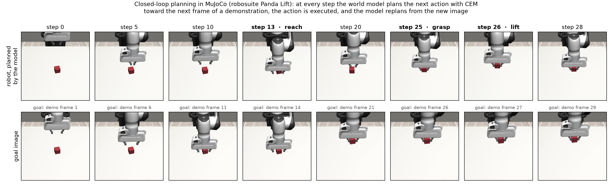
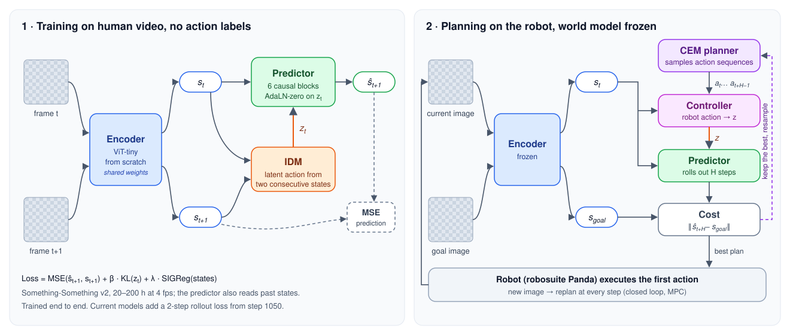
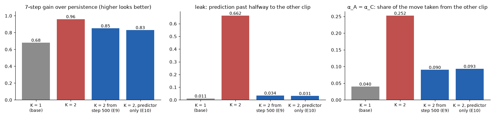
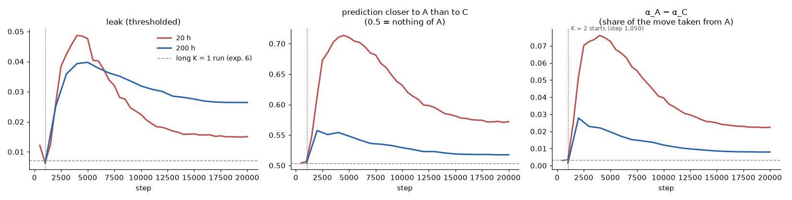
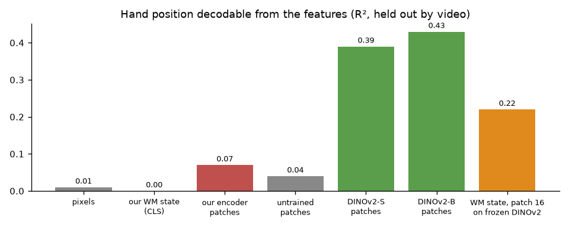
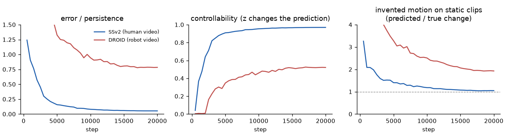
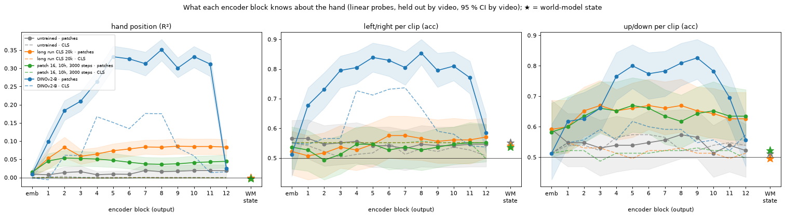
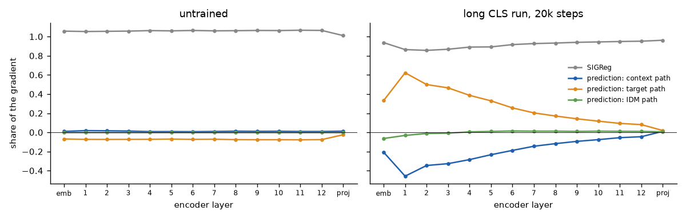
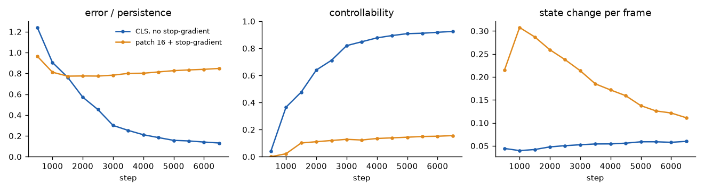
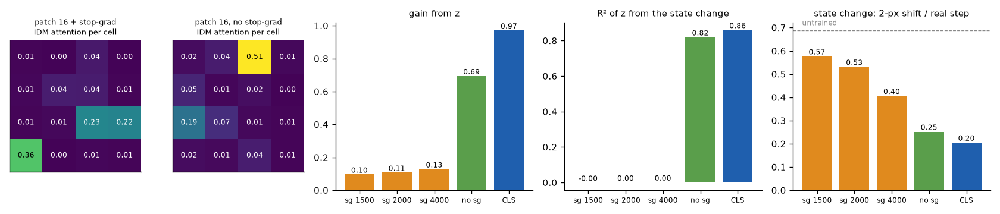

# Human-to-Robot

**Learning latent actions and visual dynamics from unlabeled human videos, then planning with them on a robot.**

Can an action-conditioned world model trained on human videos, without action labels, drive a robot with a different embodiment? We train a ViT encoder from scratch, an inverse dynamics model (IDM) and a JEPA-style predictor on 20 h of Something-Something v2. Robot actions enter through a small controller that maps them to the model's latent actions, and a CEM planner uses the model on a Panda arm in Robosuite.

So far: the model predicts human video well, and it follows robot paths when its latent actions are inferred from the frames. The robot's own actions drive it much less. The [16 experiments](#experiments) below test where it breaks.



*Closed-loop planning with the 20 h model: at each step the CEM plans the next action toward the next frame of a demonstration, the action is executed, and the model replans from the new image. This is the best episode (validation episode 20): reach at step 13, grasp at 25, lift at 26; the cube drops at step 30. It is the only lift out of 20 episodes in this setting.*



### Results at a glance

Current model (20 h, details in [Current model](#current-model)). Every number is set beside a reference. **Persistence** is the forecast that nothing changes (ŝ_t+1 = s_t); errors are given as a fraction of its error, so below 1 beats it.

| Measure | Model | Reference |
|---|---|---|
| Next-state error, held-out SSv2 | 0.0135 | persistence (no change) 1 |
| 7-step rollout error, held-out SSv2 | 0.013 | persistence 1 |
| Motion invented on still clips (predicted / true change) | 1.09 | 1 = nothing invented |
| Robot paths over 7 steps, simulation: cosine to the real path, z from the IDM / from the robot's actions | 0.94 / 0.69 | DROID: 0.83 / ≤ 0.09 ([exp. 14](#14-do-real-robot-actions-drive-the-model)) |
| Hit rate Top-1 / Top-5 of the true actions among 64, goal 3 steps ahead | 10.4 % / 31.9 % | chance 1.6 % / 7.8 % |
| Offline FDE: Δxyz L1 error of the CEM plan, goal 7 steps ahead | 0.122 | zero plan 0.087, another episode's move 0.130 |
| Same, 1 action toward the next frame: gain on the zero plan, all clips / most moving third | −0.006 / +0.0045 | 0 = as good as not moving |
| Closed loop, 20 episodes: reach / grasp / lift, best of 7 planner settings for each stage taken separately (no single setting reaches 7 / 3 / 1) | 7 / 3 / 1 | recorded actions 18 / 19 / 16, zero plan 0 / 0 / 0 |
| Gripper closure readable from the state (linear probe R²) | 0.04 | frozen DINOv2-S: 0.84 |

### Three findings in figures

**More video keeps helping.** Prediction error falls about 20 % per doubling of SSv2 video, with no saturation up to 8 h; more classes at equal hours help more ([exp. 4](#4-does-more-video-help)).


**A 2-step rollout loss looks better for the wrong reason.** Every prediction metric improves, but the latent action starts carrying the next frame (leak 1 % → 66 %). Starting the term later or applying it to the predictor only brings `leak` down to 3 %, but this measure has a threshold and hides most of what remains: the share of the predicted move taken from the other clip falls only from 0.25 to 0.09 (0.04 without the term). In 20,000-step runs it peaks, then decays while the learning rate falls, and never returns to the level of a run without the term ([exp. 5](#5-does-a-2-step-rollout-loss-help), [exp. 11](#11-how-much-does-the-leak-metric-hide), [exp. 12](#12-long-training-on-20-h-of-all-classes)).





**The encoder does not learn where the hand is.** A linear probe reads the hand position from frozen DINOv2 patches (R² 0.39–0.43) but hardly from our states (0.00–0.07, untrained 0.04) ([exp. 7](#7-do-the-states-know-where-the-hand-is)).



### Open questions and next experiments

One experiment at a time; the decision rule is fixed before each run.

| Question | Hypothesis (untested) | Next experiment |
|---|---|---|
| Why is the planned move less accurate than not moving, offline? | The action → controller → z path does not pin the action, and the CEM spends its effort cancelling motion the model invents on still scenes. Over a few steps the true move is small, so not moving is a strong reference. | Plan toward the current state, where the right answer is not to move, to measure the CEM's own bias; CEM toward goals 1, 2, 3 and 7 steps ahead; then plan directly over z (latent actions follow real paths: cosine 0.94) and decode z → action. |
| Why is the hand, and the gripper, invisible to the encoder? | The objective: SIGReg drives most of the encoder gradient (exp. 8), so small fast parts are ignored. | Per-layer hand probe on the 200 h model; rebalance the prediction and SIGReg terms and follow the probe. |
| Is the 2-step rollout loss worth its leak? | The gains rely on the leak, which planning cannot use. | K = 1 against K = 2 on the same data and seed; start the term by steps, epochs or learning rate. |
| How small can the latent action be? | z already uses 5–8 active dimensions of 64; a tighter bottleneck may cut the leak and keep the motion. | z of 2 / 4 / 8 / 64 dimensions, a stronger KL, a discrete z. |
| Do more and more varied human videos help? | Diversity beat quantity at 8 h (exp. 4). | Mixes of SSv2 (197 h), EPIC-KITCHENS-100 (100 h), Charades (81 h) and EgoDex (7.6 h) against SSv2 alone, at equal hours. |
| Is the predictor the right size? | Its MLP (10.7 × the width, from LeWM) was never tuned. | Predictor sizes on a fixed encoder. |
| Do human videos help a robot? (the goal) | | Human + robot video against robot only, on the same robot tasks. |

## Quickstart

```bash
uv sync

# frame shards from a folder of videos (configs/data/config.yaml); our SSv2 copy on the Hub is private (licence)
uv run h2r data extract --set raw_dir=data/raw/ processed_dir=data/processed/

# world model, current recipe: 20,000 steps, 2-step rollout loss from epoch 1, β 3e-4
uv run h2r train wm --set name=<run> data.processed_dir=data/processed/ \
    loss.rollout_steps=2 loss.rollout_from_epoch=1 loss.beta=0.0003 iterations=20000

# controller (robot action -> z) on the simulated episodes, public: batgre/h2r-sim-v3
uv run h2r train controller --set world_model=outputs/<run> data.root=data/h2r-sim/ data.hf_repo=batgre/h2r-sim-v3

# closed-loop planning in robosuite Lift, dense subgoals t+1
uv run h2r plan run --set policy.controller=outputs/<controller run> policy.goal=dense policy.k=1 policy.horizon=1
```

Every command, data preparation and options included: [Command reference](#command-reference).

## Current model

The reference world model is the 20 h run of experiment 12: `wm-cls-ssv2-20hall-k2from1050-b3e-4-20k`, checkpoint `step-20000.pt`, trained at commit `248588a`.

| Part | Specification | Parameters |
|---|---|---:|
| Encoder | ViT-tiny from scratch: 224 px, patch 14, 192-d, 12 layers, 3 heads | 5.50 M |
| Projector | MLP on the CLS token: 192 → 2048 → 192, BatchNorm, GELU | 0.79 M |
| IDM | Pairs (s_t, s_t+1), 2 transformer layers, 4 heads, read by one query; Gaussian z, 64-d | 1.36 M |
| Predictor | 6 layers, causal, 16 heads of 64, MLP 2048, AdaLN-zero on z, RoPE on time; predicts the next state directly | 10.80 M |
| Prediction projector | MLP: 192 → 2048 → 192, BatchNorm, GELU | 0.79 M |
| **Total** | | **19.25 M** |

| Training | Value |
|---|---|
| Data | SSv2 20 h: 19,301 videos, 20.9 h, 168 classes, 4 fps, no action labels |
| Clips | 8 consecutive frames (2 s), 7 transitions |
| Loss | teacher forcing + 2-step rollout from step 1,050 (last-gradient only, 3 states of context) + β KL + λ SIGReg |
| Weights | β 3e-4, λ 0.09 |
| Stop-gradient on the target | None |
| Optimizer | AdamW, lr 1e-4, weight decay 1e-3, 10% warmup, gradient clip 1.0, bf16 |
| Length | 20,000 steps, batch 128, seed 0 |

Measured on validation at step 20,000:

| Metric | Value |
|---|---|
| Error / persistence | 0.0135 |
| 7-step gain over persistence | 0.987 |
| Controllability | 0.99 |
| Leak | 0.015 |
| Invented motion | 1.09 |
| Rank of the states (RankMe) | 72 / 192 |
| Active dimensions of z | 8 / 64 |
| Action class from z | 0.015 (chance 0.006) |
| Left / right from z | 0.50 (chance 0.50) |
| Hand R² from the encoder | 0.08 |

These numbers do not show that the model is usable for control: see experiments 14 to 16.

### Planning metrics

Kept up to date: every new world model gets the same measures, on the same windows, so its progress on the task can be followed. Robosuite Lift, simulation validation episodes (210), controller `ctrl-sim`, context of 2 states, 3 actions planned. Intervals are 95 % bootstrap over episodes.

Each table has one row per world model, so models can be compared directly. 20 h: `wm-cls-ssv2-20hall-k2from1050-b3e-4-20k`; 200 h: `wm-cls-ssv2-200hall-b256-k2from1050-b3e-4-20k`; both `step-20000.pt`, each with its own `ctrl-sim`. Offline numbers come from `h2r plan offline` (`outputs/planning-offline/`).

**Success rate, closed loop** (20 episodes, counts; details in [Closed loop](#closed-loop-mpc-in-robosuite))

| Planner | Model | Reach | Grasp | Lift |
|---|---|---|---|---|
| Recorded actions (reference) | | 18 | 19 | 16 |
| Zero plan (reference) | | 0 | 0 | 0 |
| Final goal, H = 1 | 20 h | 0 | 0 | 0 |
| | 200 h | 0 | 1 | 0 |
| Final goal, H = 2 | 20 h | 1 | 1 | 0 |
| | 200 h | 1 | 0 | 0 |
| Final goal, H = 3 | 20 h | 0 | 0 | 0 |
| | 200 h | 0 | 0 | 0 |
| Stage subgoals, H = 1 | 20 h | 3 | 1 | 0 |
| | 200 h | 0 | 1 | 0 |
| Stage subgoals, H = 2 | 20 h | 5 | 3 | 1 (pushed) |
| | 200 h | 3 | 4 | 1 |
| Dense subgoals t+1, H = 1 | 20 h | 4 | 3 | 1 |
| | 200 h | 7 | 2 | 0 |
| Dense subgoals t+7, H = 3 | 20 h | 7 | 3 | 0 |
| | 200 h | 1 | 1 | 0 |

Counts out of 20. 95 % Wilson intervals: 0 → 0–16 %, 1 → 1–24 %, 2 → 3–30 %, 3 → 5–36 %, 4 → 8–42 %, 5 → 11–47 %, 7 → 18–57 %, 16 → 58–92 %, 18 → 70–97 %, 19 → 76–99 %. With 20 episodes, almost no difference between two settings is significant.

**Hit rate**: rank of the true actions among 64 action sequences (the true ones and 63 from other episodes), Sim val.

| Model | Top-1, goal 3 steps | Top-5, goal 3 steps | Top-1, goal 7 steps | Top-5, goal 7 steps |
|---|---|---|---|---|
| Chance | 1.6 % | 7.8 % | 1.6 % | 7.8 % |
| 20 h | 10.4 % | 31.9 % | 4.5 % | 20.1 % |
| 200 h | 11.8 % | 39.3 % | 5.3 % | 22.9 % |

**FDE**: Δxyz L1 error of the CEM plan against the real move, goal 7 steps ahead, 3 actions planned, Sim val. Lower is better.

| Model | CEM | Zero plan | Another episode's move | CEM − zero plan |
|---|---|---|---|---|
| 20 h | 0.122 | 0.087 | 0.130 | −0.035 [−0.039, −0.030] |
| 200 h | 0.136 | 0.087 | 0.130 | −0.049 [−0.053, −0.044] |

**Offline verdict**: same measure, run once on the test set. Rule: the CEM beats the zero plan overall and on the most moving third.

| Model | Sim test: CEM | Sim test: zero plan | DROID test: CEM | DROID test: zero plan | Passes |
|---|---|---|---|---|---|
| 20 h | 0.126 | 0.092 | 0.403 | 0.087 | no |
| 200 h | 0.141 | 0.092 | not run | | no |

**Direction of the plan**: cosine between the planned and the real Δxyz (0 = random), Sim val.

| Model | Real goal 7 steps ahead | Amplitude (planned / real) | Goal imagined from the true actions (known case) |
|---|---|---|---|
| 20 h | 0.16 | 1.33 | 0.44 |
| 200 h | 0.20 | 1.49 | 0.38 |

**Cost gates**: does the cost rank the true actions first? Share of windows, Sim val.

| Model | True actions beat another episode's, goal 3 steps (rule ≥ 0.75) | True actions beat the zero plan, goal 7 steps (rule > 0.5) |
|---|---|---|
| Chance | 0.5 | 0.5 |
| 20 h | 0.745 | 0.633 |
| 200 h | 0.799 | 0.650 |

**State probe**: linear probe (R²) from s_t − s_0 to the change of the gripper position and of its closure, Sim val.

| Model | x | y | z | Gripper closure |
|---|---|---|---|---|
| Time alone (reference) | 0.03 | 0.00 | 0.26 | 0.05 |
| 20 h | 0.81 | 0.44 | 0.58 | 0.04 |
| 200 h | 0.81 | 0.36 | 0.63 | 0.05 |

**Diagnostics, 20 h model only** (Sim val)

| Setting | Δxyz error | Cosine to the true move | Reference |
|---|---|---|---|
| Goal imagined 7 steps ahead (no model error on the goal), 3 actions | 0.114 | 0.30 (7 steps) | real goal 0.122 / 0.30 |
| Same, all 7 actions planned | | 0.31 | 3 actions 0.30 |
| 1 action, goal 1 step ahead | 0.044 | 0.31 | zero plan 0.038 |

- **Measured:** the gap to the zero plan shrinks as the goal gets closer: CEM / zero plan 1.40 at 7 steps (0.122 / 0.087), 1.16 at 1 step (0.044 / 0.038). At 1 step the CEM beats the zero plan on the most moving third (+0.0045 [+0.0020, +0.0070]). Goals 2 and 3 steps ahead were not planned.
- By definition, the zero plan's error is the size of the true move, small from one frame to the next, so not moving is a strong reference over a few steps.
- **Measured:** the zero action is not still in the model (invented drift).
- **Inferred:** on calm windows the CEM moves to cancel this drift, hence its loss on Δxyz.
- **Untested:** whether the CEM's move opposes the drift. Planning toward the current state, where the right answer is not to move, would measure it.

#### Closed loop (MPC in robosuite)

20 scripted simulation validation episodes whose recording lifts the cube, same seed (same cube) as the recording. At each step the rendered frame goes through the data chain (H.264, then JPEG) and the encoder. The CEM (300 plans, 30 elites, 10 iterations, start at the controller's action mean and std) plans H actions toward the goal. The first action is executed by a calibrated delta command (command = Δxyz / K, held 5 control steps; rotation 0; gripper closes or opens past a Δclosure of ±0.05). Then it replans: 40 steps, context of 2 states linked by the controller's z of the achieved action.

Stages, each counted if met at any step:
- **reach**: gripper centre within 3 cm of the cube centre;
- **grasp**: both finger pads touch the cube (robosuite `_check_grasp`);
- **lift**: cube centre more than 4 cm above the table (robosuite Lift success test).

Goals:
- **final goal**: the last frame of the recording (cube held up), at every step;
- **stage subgoals** (as V-JEPA 2-AC's subgoal images): the recorded frame where reach is first met, then the one where grasp is first met, then the final frame. Each one is the goal until the recording reaches that stage (stage times from an exact replay of the recorded commands);
- **dense subgoals t+k**: the recorded frame k steps after the current step.

Success counts are in the [Success rate](#planning-metrics) table above. The details of each run:

| Planner | Model | Steps to reach / grasp / lift | Final error: gripper / cube | Time per step |
|---|---|---|---|---|
| Recorded actions, same executor (reference) | | 10 / 17 / 18 | 1.7 / 1.7 cm | 0.43 s |
| Zero plan (reference) | | – / – / – | 12.4 / 11.9 cm | 0.43 s |
| Final goal, H = 1 | 20 h | – / – / – | 6.7 / 11.9 cm | 0.56 s |
| | 200 h | – / 32 / – | 23.1 / 11.9 cm | 0.21 s |
| Final goal, H = 2 | 20 h | 22 / 10 / – | 14.9 / 11.9 cm | 0.70 s |
| | 200 h | 8 / – / – | 42.0 / 11.9 cm | 0.39 s |
| Final goal, H = 3 | 20 h | – / – / – | 19.9 / 11.9 cm | 0.87 s |
| | 200 h | – / – / – | 26.2 / 11.9 cm | 0.58 s |
| Stage subgoals, H = 1 | 20 h | 20 / 11 / – | 14.8 / 12.1 cm | 0.64 s |
| | 200 h | – / 12 / – | 23.9 / 12.1 cm | 0.21 s |
| Stage subgoals, H = 2 | 20 h | 14 / 8 / 24 | 18.5 / 12.1 cm | 0.76 s |
| | 200 h | 7 / 10 / 38 | 32.4 / 12.1 cm | 0.39 s |
| Dense subgoals t+1, H = 1 | 20 h | 17 / 13 / 23 | 6.9 / 11.9 cm | 0.47 s |
| | 200 h | 9 / 9.5 / – | 17.9 / 12.4 cm | 0.21 s |
| Dense subgoals t+7, H = 3 | 20 h | 13 / 16 / – | 19.5 / 12.0 cm | 0.86 s |
| | 200 h | 8 / 14 / – | 21.7 / 11.9 cm | 0.58 s |

Steps to a stage: median over the episodes that reach it. Final error: distance at step 40 to the recording's final gripper position and final cube position. Time per step: wall clock on a MacBook (MPS), rendering and simulation included (0.43 s without planning). 200 h: its ctrl-sim `best.pt` at step 22,500, `outputs/planning-200h/` (12 Nov.).

**20 h model**

- **Measured:** no planner lifts the cube in a stable way. The one lift with dense subgoals t+1 (episode 20) grasps the cube at step 25, holds it 5 steps and lifts it at steps 26–28, up to 7 cm above its resting height; the cube is back on the table at step 30. The stage-subgoal lift (episode 134) is the cube at 4.1 cm for one step, without a grasp at that step: pushed, not lifted (inferred).
- **Measured:** grasps last 1 or 2 steps (recorded actions: 22). The gripper is commanded closed / open 6 to 8 times per episode (recording: once).
- **Measured:** with the final goal alone the arm moves about 8 cm in 5 steps, then stays 13–14 cm from the cube, for every H. With subgoals it comes to about 7 cm near step 15, then moves away when the goal becomes the lifted cube. Every planner ends 13–16 cm from the cube.
- **Measured:** the recorded actions through the executor lift 16 / 20 (recording 20 / 20 on these episodes): without replanning, a drift of 1–2 cm at closing time flips marginal grasps (on 119 episodes: 10 lost, 9 gained).
- **Inferred:** the subgoals help the approach (reach 3–7 / 20 against 0–1 with the final goal), not the grasp: the state does not hold the gripper closure (probe R² 0.04), so the CEM plans it at random.

**200 h model**

- **Measured:** the one lift (stage subgoals H = 2, episode 291) is held: grasped on 21 of the last 32 steps, cube about 4 cm above its rest height at step 38 while grasped. Other grasps last 1 to 4 steps; two of them (final goal H = 1, stage subgoals H = 1) come without reach, the fingers closing on an edge with the gripper centre 3.0–3.5 cm away.
- **Measured:** the arm ends farther from the recorded final position than with the 20 h model in every setting (17.9–42.0 cm against 6.7–19.9 cm); the offline plans are also larger (amplitude 1.45 against 1.24 on Sim test).
- **Measured:** offline verdict on Sim test fails as for the 20 h model: Δxyz L1 error 0.141 [0.138, 0.145] against 0.092 for the zero plan; the cost gate on other episodes passes (0.803 [0.795, 0.810]).

## Experiments

The model is a JEPA world model (LeWM recipe): a ViT-tiny encoder trained from scratch, an IDM that infers a latent action z from two consecutive states, and a predictor conditioned on z. It is trained on Something-Something v2 (SSv2) video at 4 fps, with no action labels. Each experiment below answers one question. Every result is labelled **measured** (observed in a run) or **inferred** (our reading of it).

Metrics used throughout, all on held-out validation videos:
- **error / persistence**: next-state prediction error divided by the error of copying the current state. Below 1 means the model beats copying.
- **controllability**: how much the prediction changes when z comes from another clip (0 means z is ignored).
- **leak**: z of clip A is applied to clip B. Three measures of how much of A's future it carries (copying the future instead of describing an action):
  - `leak`: share of predictions that land closer to A's next state than to B's. It only fires past halfway from B to A, so it misses smaller leaks;
  - prediction closer to A than to C (`leak_a_vs_c`), C an unrelated clip: 0.5 means nothing of A;
  - α_A − α_C (`leak_alpha`): position of the prediction on the way from B to A (0 at B, 1 at A), minus the same toward C. The share of the move taken from A, without a threshold.
- **invented motion**: on static clips, predicted change / true change (1 is ideal).

Unless stated otherwise: batch 128, lr 1e-4, KL weight β 1e-4, SIGReg λ 0.09, one seed.

Data, split by whole video or episode:

| Dataset | Content | Used for |
|---|---|---|
| SSv2 10 h | 20 action classes | World model |
| SSv2 20 h | 19,301 videos, 168 action classes (classes where the camera moves are left out) | World model |
| [DROID](https://huggingface.co/datasets/batgre/h2r-droid) | 10 h of real robot episodes, left exterior camera, with actions | World model control, controller |
| [Robosuite](https://huggingface.co/datasets/batgre/h2r-sim-v3) | Panda Lift, 1,100 scripted and 1,100 random episodes, with actions | Controller |

### 1. Does the latent action carry the prediction?

1,000 steps on 5 h of SSv2, the normal model against z = 0.

- **Measured:** error / persistence is 0.82 with z and 1.10 with z = 0. Without z the model never beats copying.
- **Measured:** the temporal and posterior collapses seen when overfitting one batch do not appear on real data.
- **Inferred:** the IDM carries the gain. The overfit test cannot judge z, because the predictor memorises a single batch from context alone.

### 2. Learning rate, predictor form and seed noise

1,000 steps each.

| Question | Result (error / persistence) |
|---|---|
| Learning rate 2.5e-5 / 5e-5 / 1e-4 / 2e-4 / 4e-4 | 0.92 / 0.82 / 0.48 / 0.38 / 0.57; 4e-4 is unstable (z dimensions oscillate) |
| Direct vs residual predictor (s_t + Δ, zero-initialised) | 0.475 vs 0.787. The residual predictor plateaus from step 200 and predicts changes half their true size |
| Seed noise, 3 seeds of the base | 0.40 / 0.27 / 0.35 (std 0.05) |

- **Measured:** spread across seeds follows how much z is used. The IDM switches on at a seed-dependent step (200–400).
- **Inferred:** single-seed gaps under about 0.1 are noise.
- **Code:** the residual predictor is removed from this branch; the direct one stays (last version with it in `59ae203`).
- **An invalid experiment, caught:** a first CLS-vs-patch comparison reported 0.48 vs 0.77. Both runs were in fact CLS, because the Colab code ignored a config key. The 0.3 gap came from initialisation alone. Since then, runs assert the state shape.

### 3. KL weight and SIGReg weight

1,000 steps.

| | error / persistence | KL (nats) | Notes |
|---|---|---|---|
| β 0 / 1e-4 / 1e-3 / 1e-2 | 0.35 / 0.40 / 0.75 / 0.99 | 158 / 34 / 3.2 / 0.23 | content leak 2.2 % / 0.8 % / 0.3 %; β 1e-4 kept |
| λ 0.03 / 0.09 / 0.27 | 0.28 / 0.40 / 0.41 | | effective rank 36 / 54 / 63; gradient clipping on 11 % / 52 % / 100 % of steps |

- **Measured:** a larger β halves the predicted motion (0.83 → 0.34 of the true change on moving clips). This is the KL bottleneck.
- **Measured:** invented motion on static clips is the same at every β (1.6–1.8). It comes from the predictor, not from z.

### 4. Does more video help?

Nested SSv2 subsets, 3,000 steps each.


- **Measured:** error / persistence falls by about 20 % per doubling of data (0.29 at 1 h → 0.14 at 8 h), with no sign of saturation.
- **Measured:** at equal hours, 20 classes beat 10 classes (0.116 vs 0.143), even on the original classes.
- **Inferred:** diversity matters more than quantity at this scale.

### 5. Does a 2-step rollout loss help?

3 seeds per condition, 1,000 steps.


- **Measured:** with K = 2, every prediction metric improves (7-step gain over persistence, 1 - error / persistence: 0.68 → 0.96). `leak` rises from 1 % to 66 %, α_A − α_C from 0.04 to 0.25.
- **Inferred:** the predictor reads its own noisy prediction while z comes from an IDM that sees the true future. Putting the future into z is the cheapest way down the loss. These gains rely on that leak, which is unavailable at planning time.
- **Measured:** two fixes bring `leak` back to about 3 %: starting K = 2 at step 500 (E9), or applying the term to the predictor only (E10). The threshold-free α_A − α_C only falls to 0.09, still more than twice K = 1 (experiment 11).
- **How we use it:** leak is now a hard constraint before ranking any model on prediction metrics, read on the threshold-free measures.

### 6. Long training, and the positive control on robot video

20,000 steps, one run per dataset: SSv2 10 h / 20 classes, and DROID 10 h (robot video, left exterior camera).



On SSv2 (measured):
- error / persistence reaches 0.054 and 7-step gain over persistence 0.92;
- controllability is 0.97, and the leak stays at 0.65 % for the whole run;
- invented motion falls to 1.05;
- validation error is still falling when the learning rate reaches 0.

On DROID (measured):
- error / persistence plateaus at 0.78;
- the IDM wakes up only around step 2,500 and uses 2 nats;
- a controller that maps the real robot actions into z carries no action information. Its prediction error is the same as with another clip's actions, and the probe from z to the action gives R² 0.0004.

**Inferred:** the recipe fails on robot video too, so the failure is in the representation, not in the human-to-robot gap.

### 7. Do the states know where the hand is?

Linear probes, held out by video, on SSv2 validation frames with a hand tracked by MediaPipe.




- **Measured:** our world-model states give R² 0.00, and our encoder's patch tokens 0.07, close to an untrained encoder (0.04). Frozen DINOv2 patches give 0.39–0.43.
- **Measured:** layer by layer, our encoder stays flat at 0.04–0.09 through all 12 blocks. The information is never built, rather than built and then lost.
- **Measured:** with a frozen DINOv2 encoder, our patch projector and loss keep the hand (0.22). A CLS state on the same encoder loses it (0.01).
- **Inferred:** the main cause is the encoder trained from scratch, not the objective erasing the information. Pooling to one CLS token adds a second loss.

### 8. Which loss term trains the encoder?

Share of each term in the encoder gradient, ⟨g_term, g⟩ / |g|², on one batch.



- **Measured:** SIGReg supplies about 90 % of the encoder gradient at every layer.
- **Measured:** the prediction loss reaches the encoder through two paths that cancel out (cosine −0.91 to −0.97):
  - the context path, through the predictor's input;
  - the target path, which pulls the target toward the prediction.
- **Measured:** the net prediction share is about 8 %.

### 9. Does the scene alone satisfy SIGReg?

SIGReg tests whether a set of states looks Gaussian (a Gaussian set scores 1.05).

| Set of 12 states | SIGReg statistic |
|---|---|
| frames from 12 different videos (as in a training batch) | 1.08–1.28 |
| 12 frames of one video | 9.6–10.1 |

- **Measured:** 79–86 % of the state variance lies between videos, for every network including an untrained one (84 %), and at every λ.
- **Inferred:** a batch of mixed videos satisfies SIGReg through scene differences alone, so SIGReg does not push the encoder to represent what changes inside a video.

### 10. Does a stop-gradient on the target help?

Patch-16 states (a 4 × 4 grid), stop-gradient on the target as in AD-E2E-JEPA, compared with the long CLS run (same schedule). The run stopped near step 9,500 and is shown up to step 6,500.



- **Measured:** error / persistence stalls at 0.77 from step 1,500, then rises to 0.85. Controllability stays at 0.10–0.16. States change 2 to 5 times more per frame than in the CLS run. Hand R² stays at 0.02–0.04.

To find the cause, we measured the checkpoints at steps 1,500, 2,000 and 4,000 on 480 validation clips:



- **Measured:** the IDM's readout attends to 2–3 fixed cells of the grid, unrelated to where pixels change. The run without stop-gradient does the same, yet uses z well (gain 0.69). This is not the cause.
- **Measured:** z is unrelated to the change of state. The linear R² of z from Δs is 0.00, against 0.82 without stop-gradient and 0.86 for CLS. z is mostly a constant that the predictor uses as a bias.
- **Measured:** the states stay close to pixels. A 2-pixel shift moves them by 40–57 % of a real time step, against 20–25 % for the trained baselines and 69 % for an untrained encoder.
- **Inferred:** the target path is what makes an encoder trained from scratch predictable. AD-E2E-JEPA can use a stop-gradient because its encoder is a frozen DINOv3.
- **Untested:** a stop-gradient with a frozen encoder, an EMA target, or a partial target gradient.
- **Code:** the stop-gradient and the patch-token states are removed from this branch; the model keeps one CLS state per frame (last version with both in `59ae203`).

### 11. How much does the leak metric hide?

Audit of `leak` on the saved checkpoints of experiments 5 and 6: 1,024 validation clips, means over 3 seeds (one long run). A is the clip that gives z, B the clip that receives it, C an unrelated clip.

| Measure | K = 1 | K = 2 | K = 2 from step 500 | Predictor only | Long K = 1 |
|---|---|---|---|---|---|
| leak | 0.011 | 0.662 | 0.034 | 0.031 | 0.007 |
| prediction closer to A than to C (0.5 = nothing of A) | 0.572 | 0.853 | 0.678 | 0.691 | 0.503 |
| part of the move that belongs to A (α_A − α_C) | 0.040 | 0.252 | 0.090 | 0.093 | 0.003 |

- **Measured:** `leak` only fires past halfway from B to A, so it is blind to everything below. The fix looks like a 95 % reduction by `leak`, and 64 % by α_A − α_C.
- **Measured:** the long K = 1 run has no content specific to A (interval 0.479–0.527 around 0.5).
- **How we use it:** both threshold-free measures now run at every validation (`latent_action/leak_a_vs_c`, `leak_alpha`).

### 12. Long training on 20 h of all classes

20,000 steps on SSv2 20 h, K = 2 from step 1,050, β 3e-4.

Measured at the end of the run:
- error / persistence 0.0135, 7-step gain over persistence 0.987, controllability 0.99;
- `leak` 0.015, prediction closer to A than to C 0.572, α_A − α_C 0.022: some content of A remains (the long K = 1 run of experiment 6: 0.007 / 0.503 / 0.003);
- hand R² from the encoder 0.08;
- action class from z 0.015 (chance 0.006).

The leak over the run, with the 200 h run (batch 256, learning rate and SIGReg scaled with it):


- **Measured:** the leak appears as soon as K = 2 starts (step 1,050), peaks around step 4,000 (20 h: α_A − α_C 0.076, prediction closer to A than to C 0.71), then decays to the end.
- **Inferred:** a 1,000-step run measures the leak on the way up, which explains most of the gap between experiment 5 (`leak` 0.034) and this run (0.015); data and β differ too.
- **Measured:** the 200 h run leaks less on the threshold-free measures (0.008 and 0.518 at the end) but more on `leak` (0.026 against 0.015). The thresholded measure ranks the two runs in the opposite order.
- **Untested:** the decay follows the cosine learning rate schedule; it may come from the falling learning rate, from β 3e-4 or from the data. The gap with experiment 6 could come from K, β or the data. Only a K = 1 run on the same data and β can tell.

### 13. Do the states separate datasets or actions?

4,148 clips from 11 sources for the datasets, 5,040 SSv2 clips for the classes. Share of the 10 nearest clips with the same label.

| Space | Same source (chance about 0.14) | Same action class (chance 0.006) |
|---|---|---|
| Pixels | 0.75 | 0.013 |
| Untrained encoder | 0.79 | 0.012 |
| Trained encoders | 0.81–0.85 | 0.013–0.017 |

- **Measured:** an untrained network already separates the sources, so most of this separation is not learned.
- **Measured:** the states do not group by action class. The model trained on DROID alone matches the SSv2 models on SSv2 classes.

### 14. Do real robot actions drive the model?

One controller per world model and dataset, 100,000 steps. Seven open-loop steps on test episodes, 100 pairs of clips on simulation and 61 on DROID. Cosine between the imagined path and the real one, with z from the IDM or from the controller and the real actions.

| World model | Simulation, IDM | Simulation, controller | DROID, IDM | DROID, best controller |
|---|---|---|---|---|
| SSv2 10 h | 0.81 | 0.50 | 0.69 | ≤ 0.09 |
| SSv2 20 h | 0.94 | 0.69 | 0.83 | ≤ 0.09 |

- **Measured:** a model trained on human video follows a simulated robot in part with its real actions. On DROID, no controller drives it, even the one trained on DROID, while z from the IDM does.
- **Measured:** the world model trained on DROID does worse than the SSv2 models: IDM 0.14 on simulation, 0.50 on DROID.
- **Measured:** against a still state after 7 steps, only the 20 h model on simulation wins (error 0.023 against 0.030; IDM 0.005).
- **Measured:** the ratio to the IDM misleads. On the DROID world model it reaches 1.0–1.6 only because z has no effect.

### 15. Does a move transfer from one clip to another?

The command of A runs on B, on the same pairs as experiment 14. Cosine with the path of A, then with the path of an unrelated clip C.

| Command | Simulation, 10 h | Simulation, 20 h | DROID, 10 h | DROID, 20 h |
|---|---|---|---|---|
| z of A | 0.77 / 0.03 | 0.60 / −0.02 | 0.13 | 0.09 |
| Actions of A, through the controller | 0.14 / 0.03 | 0.17 / −0.01 | ≈ 0 | ≈ 0 |

- **Measured:** the actions of A move B only weakly, and the intervals for A and C touch.
- **Inferred:** the controller's path follows the state more than the action. A controller given the state alone would measure this (untested).
- **Inferred:** z works inside the single simulated scene, not across DROID scenes. In one scene, a real transfer and a leak look the same, so this does not prove that z is an action.

### 16. Does planning beat doing nothing?

Offline CEM over 3 actions toward a goal state, on 64 test clips. Δxyz is the L1 error on the total move; a zero plan is not moving at all.

| Data | Controllers | Zero plan, same 64 clips | Zero plan, all clips | Move of another clip |
|---|---|---|---|---|
| DROID | 0.24–0.42 | 0.132 | 0.094 | 0.145 |
| Simulation | 0.09–0.38 | 0.070 | 0.085 | about 0.125 |

- **Measured:** every controller plans worse than the zero plan, and on DROID worse than the move of another clip.
- **Measured:** 64 clips are too few, the zero plan changes from 0.132 to 0.094 on all clips. Planning must be compared on the same clips, not against a fixed value.
- **Inferred:** the CEM pushes toward large actions that lower the imagined cost. This is not tested yet.
- **Next:** the CEM is removed from this branch (last version in `248588a`) and will be rebuilt one step at a time, starting by testing whether the cost ranks the true actions first.

## Command reference

```bash
uv sync

# raw videos -> frame shards (configs/data/config.yaml)
uv run h2r data extract --set raw_dir=data/raw/ processed_dir=data/processed/

# frame shards -> Hugging Face Hub
uv run h2r data push --set processed_dir=data/processed/ hf_repo=<user>/<dataset>

# one subset of a multi-dataset repo (batgre/h2r-human: ssv2, epic100, howto100m, ...): pushed into <repo>/<subset>/
uv run h2r data push --set processed_dir=data/processed/ hf_repo=<user>/<dataset> subset=<name>
# part of it into a local root that ClipDataset reads: chosen subsets (None = all), hours split equally among them
uv run python -c "from h2r.data.dataset import fetch; fetch('<user>/<dataset>', 'data/mix-30h', subsets=None, hours=30)"

# DROID episodes for the controller (configs/data/droid.yaml), then extract / push with the same config
uv run h2r data droid
uv run h2r data extract --config configs/data/droid.yaml
uv run h2r data push --config configs/data/droid.yaml

# world model (configs/training/world_model.yaml): the current recipe, K = 2 from epoch 1
uv run h2r train wm --set name=<run> data.processed_dir=data/processed/ \
    loss.rollout_steps=2 loss.rollout_from_epoch=1 loss.beta=0.0003 iterations=20000

# controller for a trained world model; ablations: --set 'model.inputs=[state]' or 'model.inputs=[action]'
uv run h2r train controller --set world_model=outputs/<wm-run>

# closed loop in robosuite (configs/planning/robosuite.yaml, environment configs/env/config.yaml, CEM
# configs/planning/cem.yaml): policy random | scripted | recorded | zero | cem, CEM goal final | stages | dense
# (frame t + k); stage rates, summary.json and one video per episode in outputs/planning/
uv run h2r plan run --set policy.goal=dense policy.k=1 policy.horizon=1 policy.context=2
uv run h2r plan run --set policy=configs/planning/<another cem>.yaml   # another CEM file
uv run h2r plan run --set policy.type=recorded                          # a baseline
# same, watched in the MuJoCo window (macOS needs mjpython)
uv run mjpython -m h2r.cli plan run --set env.has_renderer=true episodes.count=1

# tests
uv run pytest
```
